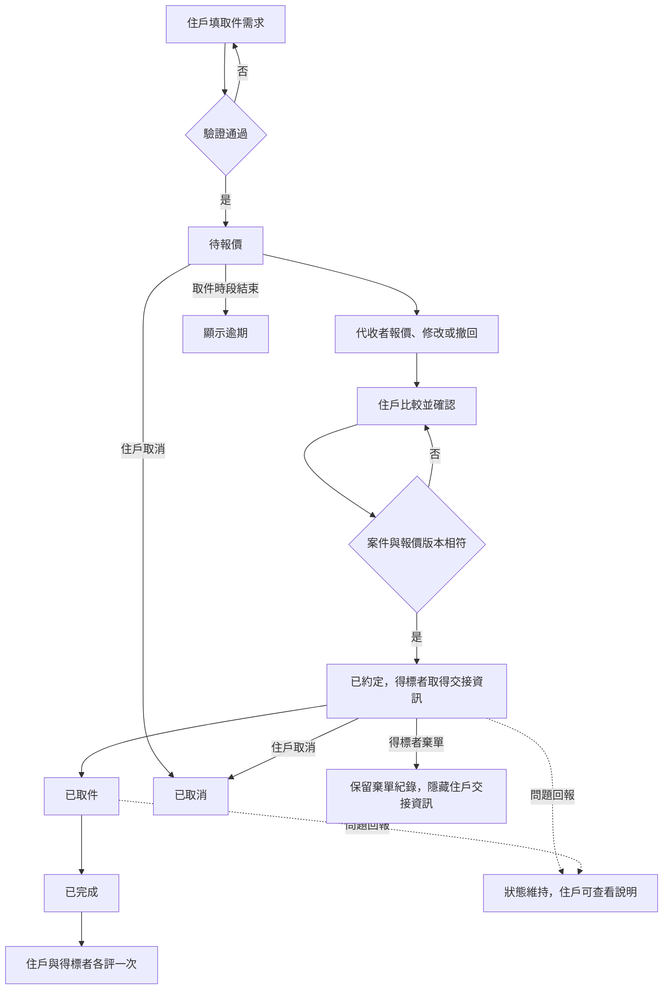
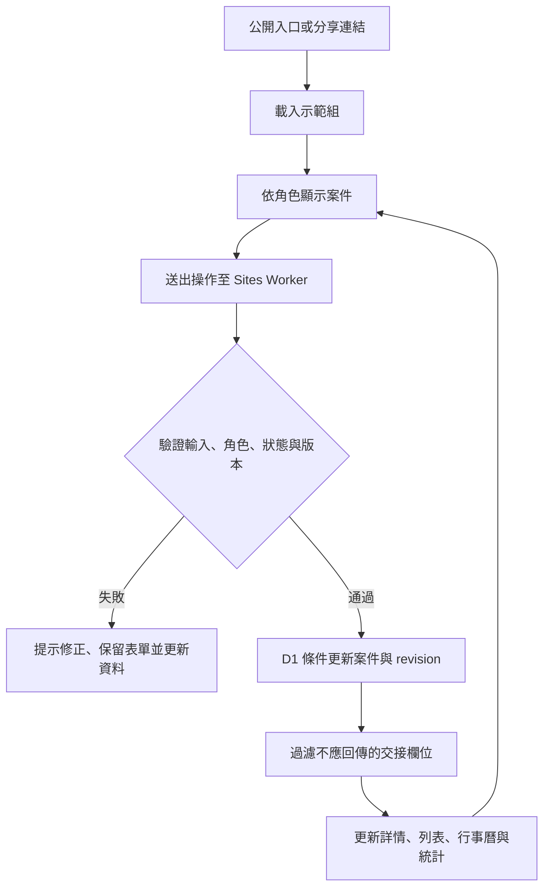

# 垃圾駱駝整合版流程

更新於 2026 年 11 月 19 日，與根目錄 spec.md 及整合簡報一致。

需要說明實作時，參考 [程式流程圖](程式流程圖.md)，包含函式呼叫、API 與資料庫版本控制、載入時序、案件狀態和錯誤處理。

## 使用者流程

已約定逾時只顯示警示，仍可補記取件。已取件後不可取消。問題回報保留最新說明，取件、完成、取消時清除。取消或棄單後由住戶依需要手動重發。

## 系統流程

示範連結跨裝置共用，有效 7 天。資料用更新資料、切換身分或頁面重新取得焦點讀回。同時寫入只成功一筆，另一筆衝突需重新確認。持有連結的人可切換所有示範角色，正式使用需要個人帳號。

## 行事曆與統計

按原定取件日列得標者的已確認、已完成和棄單。已確認包含已約定和已取件。統計按臺灣事件日期計算。完成成交金額表示議定金額，舊案缺事件時間採取件日，舊 cancelled 不補算棄單。

PNG 版本為 garbage-pickup-demo-flow.png 與 garbage-pickup-system-flow.png，完整條件以本頁及 spec.md 為準。
