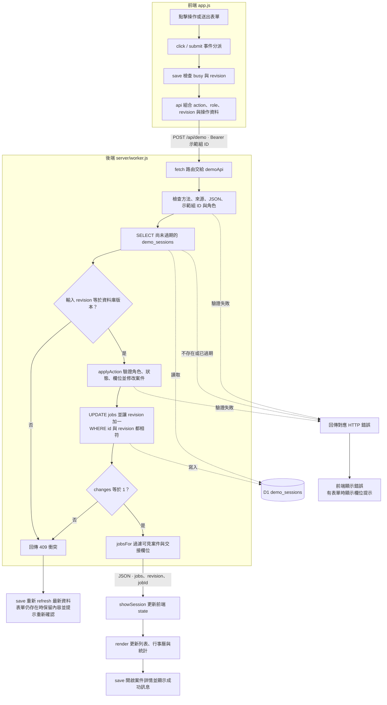
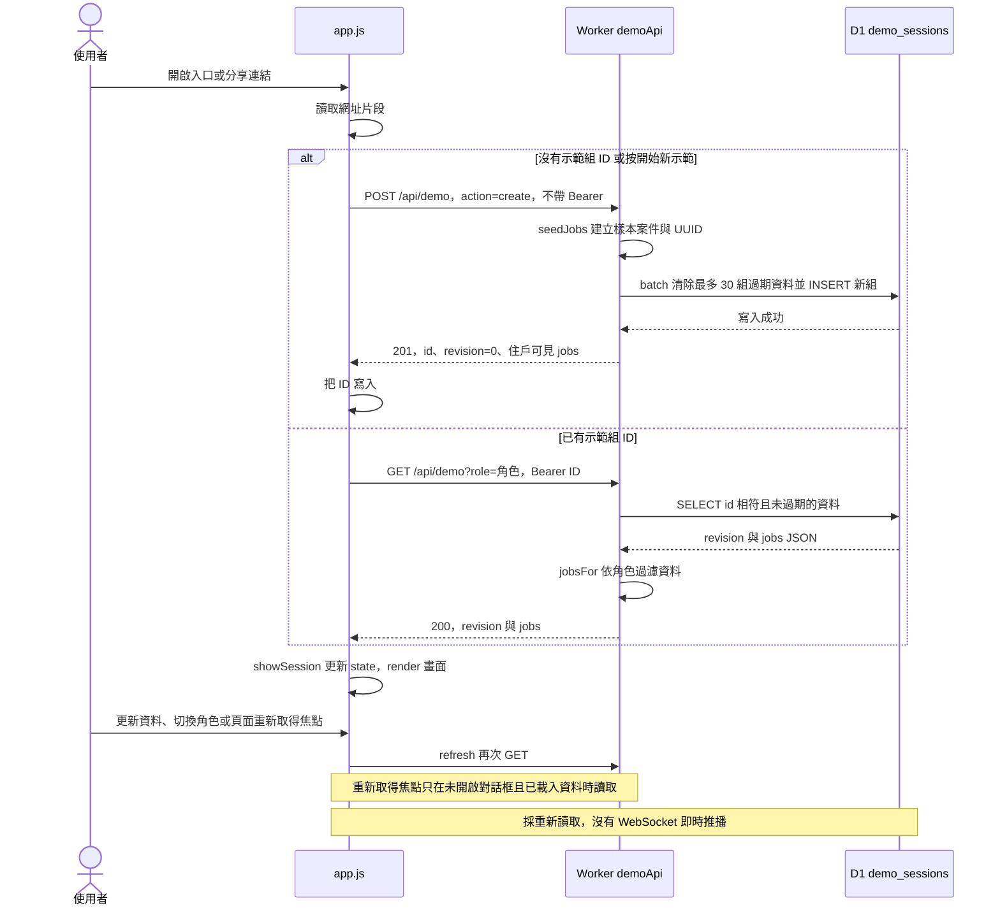
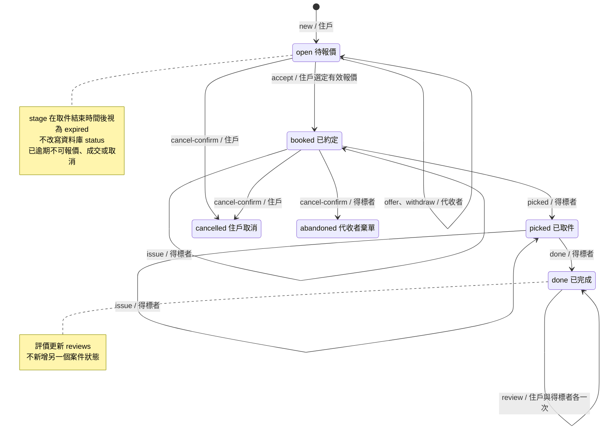

# 垃圾駱駝程式流程圖

依 2026 年 11 月 19 日整合版程式整理。圖中的名稱對應實際函式，可用來說明前端、API、資料庫及狀態控制。

## 一次操作如何寫入資料庫

以成交、取件、完成或互評為例。前端負責輸入及顯示，後端重新檢查角色、案件狀態與欄位，再以版本條件寫入 D1。



兩層版本保護各有用途。先比較輸入的 `revision`，攔住已經過時的操作。實際 `UPDATE` 再帶相同版本條件，攔住兩個請求同時讀到舊版本後的競爭。

```sql
UPDATE demo_sessions
SET jobs = ?, revision = revision + 1
WHERE id = ? AND revision = ?;
```

只有 `result.meta.changes === 1` 才回報成功。假設兩台裝置都拿到版本 5，先寫入者把版本改成 6，後寫入者用版本 5 更新會得到 0 筆，收到 409 並重新讀取。版本屬於整組示範，所以修改不同案件也可能衝突。確認成交另驗證 `offerId` 與 `offerRevision`，避免選到已修改或撤回的報價。

## 首次載入與跨裝置讀取



上述是成功路徑。缺少或格式錯誤的 ID 回傳 401，找不到或過期回傳 404。載入失敗時，`refresh` 顯示訊息，401／404 會清空目前前端案件並停用操作。

示範組 ID 是持有連結者的操作憑證。網址片段由前端讀取，再放入 API 的 Authorization header。角色由前端選擇，持有同組連結者可以切換三個虛構角色，正式個人登入尚待實作。

## 後端案件狀態與 action



`applyAction` 在後端維持這些限制。已取件後不可取消，棄單後不能取件、完成、回報問題或評價。`picked`、`done` 與取消／棄單會清空目前的 `issue`。住戶取消與代收者棄單都保留成交紀錄，棄單另記 `abandonedAt`，`jobsFor` 對代收者隱藏住戶地址、交接說明與聯絡方式。取消後由住戶自行重新發單。

## 函式與資料對照

| 程式位置 | 負責內容 |
|---|---|
| [app.js](../app.js) 的 click／submit 監聽 | 用 data-action 或 data-form 分派操作 |
| app.js 的 refresh | 建立或讀回示範組 |
| app.js 的 save、api | 防止重複送出，組 HTTP 請求並處理回應 |
| app.js 的 showSession、render | 更新 state，再更新列表、行事曆、統計 |
| [server/worker.js](../server/worker.js) 的 fetch、demoApi | 路由、讀取請求、示範組驗證、資料讀寫與版本控制 |
| server/worker.js 的 readBody、field、newJob | 驗證 JSON 大小、欄位、日期、袋數及取件條件 |
| server/worker.js 的 applyAction、stage | 驗證角色與狀態，執行操作、判定逾期 |
| server/worker.js 的 jobsFor | 在回傳前過濾可見案件與交接欄位 |
| [drizzle/0000_demo_sessions.sql](../drizzle/0000_demo_sessions.sql) | 一組示範一列，包含 id、revision、jobs JSON、expires_at |
| [test/worker.test.mjs](../test/worker.test.mjs) | 驗證同時成交、保存、隔離、互評及棄單限制 |

目前案件、報價、評價存於同一列的 `jobs` JSON，尚未拆成各自獨立的資料表。行事曆與統計由前端根據後端回傳的可見案件計算。

## 錯誤處理與簡報說法

| 情況 | 目前程式行為 |
|---|---|
| JSON、欄位、角色或操作狀態不符 | 回傳 400、403、409、413 或 415 等對應錯誤，前端提示原因 |
| 修改請求來源不同 | 回傳 403。只在 POST 帶 Origin 時檢查 |
| 版本或報價改變 | 回傳 409，前端重新讀取，請使用者重新確認 |
| 後端資料庫或未預期錯誤 | fetch 捕捉並回傳 503 |
| 斷線或超過 10 秒 | api 提示錯誤，有表單時保留輸入，先更新確認結果再重送 |

逾時只代表前端停止等待，後端仍可能已寫入，所以程式不會自動重送。

主圖可用約 60 至 90 秒說明。講法可用「前端把操作送到同一個 API，後端重新驗證，再用 revision 條件更新避免資料互相覆蓋。成功後過濾角色可見資料，前端重畫案件、月曆與統計」。載入時序及狀態圖可作技術問答備用。
